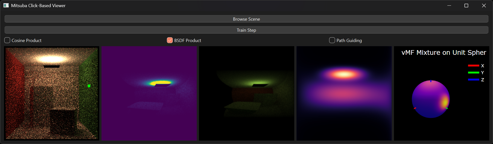
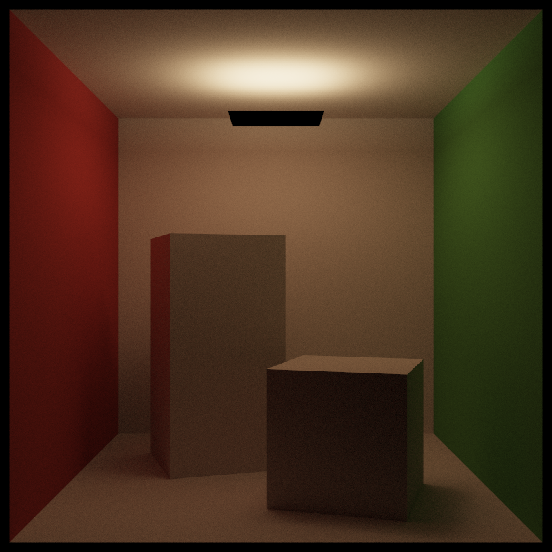
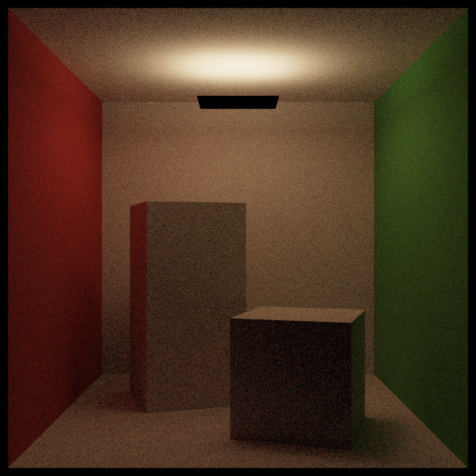

# Neural Path Guiding

A neural path guiding framework for Mitsuba 3, implemented in Python for learning and experimentation.
It implements three published guiding methods on a shared path tracer, a neural radiance cache, and a
PyQt viewer for inspecting renders, guiding distributions and training data.



## Results & Comparison

[](https://USharma002.github.io/py-neural-path-guiding/)

**[🔴 Click Here to Open Interactive Comparison with patch comparison](https://USharma002.github.io/py-neural-path-guiding)**

*View interactive sliders, variance heatmaps, and RelMSE metrics directly in your browser.*

### Method Comparison (Equal Samples)

| Ground Truth (10k SPP) | Baseline (Unguided) | Neural Guiding (vMF) | Neural Guiding (DF)  |
| :---: | :---: | :---: | :---: |
|  |  |  |  |

> **Note:** The images show the Cornell box at **1000 spp** per method. They were rendered with an earlier version of the methods.

---

## Guiding Methods

Each method follows its paper: it learns the product of BSDF, incident radiance and cosine, trained with the
Monte Carlo KL-divergence gradient weighted by `f · L_i · cos / p`, where `p` is the density that sampled the direction.

| Method | Paper | Representation |
| --- | --- | --- |
| **NPM (vMF)** | Dong et al., *Neural Parametric Mixtures for Path Guiding*, SIGGRAPH 2023 | Network-predicted mixture of 8 von Mises-Fisher lobes |
| **NIS** | Müller et al., *Neural Importance Sampling*, TOG 2019 | Piecewise-quadratic coupling flow, MIS-aware training |
| **DF** | Figueiredo et al., *Neural Path Guiding with Distribution Factorization*, EGSR 2025 | Marginal and conditional 1D grids; uses the NRC as its radiance cache |

The **Neural Radiance Cache** (Müller et al., *Real-time Neural Radiance Caching for Path Tracing*, 2021) can
also terminate paths early during rendering.

Guided directions are combined with BSDF sampling by one-sample MIS, and next-event estimation weights against
the same mixture density.

## Viewer

- Real-time rendering with online training of the guide and the NRC
- Click a pixel to see the incident radiance, the learned guiding distribution (2D and an interactive 3D sphere)
  and the NRC prediction at that point
- Loss plots, frame accumulation with a variance view, and a browser for the recorded training data
- Ground-truth export at equal samples or equal time

---

## Quickstart

1. Create and activate a Python environment.
2. Install dependencies:

```bash
pip install -r requirements.txt
```

3. Run the viewer:

```bash
python main.py
```

Notes:
- A CUDA GPU is required (Mitsuba `cuda_ad_rgb` and tiny-cuda-nn).
- The 3D sphere view is optional and needs `PyQt6-WebEngine`.

---

## Project Structure

- `integrators/` — the path tracer shared by all methods: BSDF/guide MIS, NEE, NRC termination, and per-vertex
  recording of training data
- `guiding/` — the guiding methods; each defines its distribution and a small integrator subclass that chooses
  what to record and how to build its training batch (`registry.py` lists the methods shown in the viewer)
- `networks/` — the vMF parameter network and the neural radiance cache
- `distributions/` — the batched vMF mixture
- `rendering/` — frame-by-frame renderer and the built-in test scene
- `sensor/` — the hemisphere camera used by the inspection panel
- `ui/` — PyQt viewer and dialogs
- `utils/` — math and visualization helpers

To add a method, implement a `GuidingDistribution`, subclass `PathGuidingIntegrator` next to it, and register
the subclass in `guiding/registry.py`.

---

## Notes

This repository is a learning project. It favors clarity over rendering speed: the guided integrator calls
PyTorch networks from inside the Mitsuba path loop, which is much slower than Mitsuba's own path tracer.

---

## Contributions

Contributions, suggestions, and feedback are welcome.
Feel free to open issues or submit pull requests.
